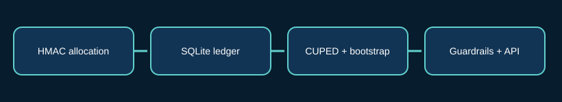

# CausalPilot · Experiment Analytics Platform

A small, inspectable experimentation backend for deterministic A/B assignment, idempotent outcome ingestion, and exploratory treatment-effect reporting. The core is Python standard library; FastAPI is an optional adapter.



## What it does

- **Stable randomized allocation.** HMAC-SHA256 assigns a subject to A or B using a versioned experiment identifier and secret salt. Assignments are persisted and cannot silently change when a user returns.
- **Auditable outcome ledger.** SQLite foreign keys, immutable experiment configuration, unique subject outcomes, and payload-aware event replay prevent accidental double counting.
- **Experiment analysis.** Mean revenue, conversion rate, refund guardrail, CUPED-adjusted revenue, bootstrap difference intervals, and sample-ratio mismatch checks.
- **Operational interfaces.** CLI, FastAPI, Docker Compose, and a reproducible synthetic dataset with deterministic seed.
- **Explicit caveats.** This is an educational/reference implementation, not a statistically certified decision engine or a privacy-compliant production telemetry stack.

## Quick start

```bash
python -m venv .venv
source .venv/bin/activate
python -m pip install -e '.[api,dev]'
pytest
python scripts/run_demo.py
python -m causalpilot --db /tmp/cp.sqlite3 generate checkout-demo --salt synthetic-only-demo-salt --n 800 --output /tmp/events.csv
python -m causalpilot --db /tmp/cp.sqlite3 ingest /tmp/events.csv
python -m causalpilot --db /tmp/cp.sqlite3 report checkout-demo
```

The demo and sample data contain synthetic subjects only. Use a secret salt and appropriate consent/data governance for any real experiment. For API development:

```bash
CAUSALPILOT_DB=/tmp/causalpilot.sqlite3 uvicorn causalpilot.api:app --reload
# Interactive OpenAPI: http://127.0.0.1:8000/docs
```

Docker: `docker compose up --build`. Compose binds to localhost and persists a named volume; it is **not** an internet-facing deployment configuration.

## Statistical contract

Each observed subject has one final outcome; missing outcomes are reported separately from assignments. Primary difference is `mean(B) - mean(A)` in the original units. CUPED uses a pooled preperiod coefficient, centering on the pooled preperiod mean. The reported percentile bootstrap interval uses independent resampling within arms with 1,200 draws and a fixed seed. A two-arm Pearson chi-square SRM check uses the planned allocation proportion. `planned_looks` divides alpha across planned inspections; **this alone does not make exploratory bootstrap intervals sequentially valid**. The system does not calculate formal sequential stopping boundaries or multiplicity-adjusted decisions across metrics. See [methodology](docs/methodology.md).

## API

| Route | Purpose |
| --- | --- |
| `GET /health` | Liveness |
| `POST /experiments` | Register immutable experiment |
| `GET /experiments/{id}/assign/{subject}` | Persist/retrieve arm |
| `POST /outcomes` | Ingest one subject outcome, idempotently |
| `GET /experiments/{id}/report` | Compute metrics, guardrails, diagnostics |

For request examples and response semantics, see [API reference](docs/api.md).

## Repository map

`src/causalpilot` contains allocation, models, storage, statistics, synthetic data, service, CLI, and API. `tests/` covers deterministic allocation, idempotency, statistics, CSV, end-to-end flow, and API. `scripts/` regenerates demonstration outputs and the SVG architecture. `data/` contains synthetic events; `ci/` contains an **inactive** workflow template that can be copied to the repository's top-level `.github/workflows/` when permissions allow. `docs/` describes methodology, decisions, threats, and operational limits.

## Engineering decisions

SQLite keeps the system reproducible without external services; write-heavy telemetry should use a queue and a stronger datastore. Assignment is deterministic but its secrecy depends on protecting the salt. One outcome per subject is deliberate for a clean experimental unit; repeated purchases require aggregation upstream. Reports are generated on demand rather than cached, which makes them easy to audit but expensive at scale.

**Status:** Locally testable reference implementation. No claim of production deployment, external validation, or statistical certification. Maintainer: Sailesh (`saileshfaze`). MIT © 2026 Sailesh.
