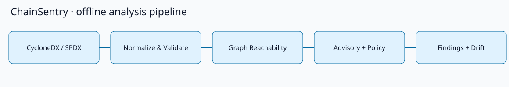

# ChainSentry · SBOM Policy Engine

**Offline software supply-chain inventory and policy analysis** for CycloneDX JSON and SPDX JSON. ChainSentry normalizes package inventories, traverses dependency graphs, matches an explicitly supplied advisory feed, evaluates license and vulnerability policy, and stores scan history for drift review.



## Why this project exists

A raw SBOM is an inventory, not a release decision. ChainSentry adds a reproducible evaluation layer: a versioned advisory feed, a documented fail threshold, visibility into transitive dependencies, time-bounded exceptions, and evidence of changes between scans. It deliberately runs without external security APIs so a sample can be reproduced offline.

This is a **reference implementation**, not a replacement for a maintained vulnerability database, a full SPDX/CycloneDX validator, or a production security gate. The bundled advisories and packages are fictional.

## Architecture

| Module | Responsibility |
| --- | --- |
| `parser.py` | Normalize CycloneDX 1.5-style and SPDX 2.3-style JSON subsets; reject dangling graph edges. |
| `graph.py` | Shortest root-to-component paths and strongly connected components, including cycles. |
| `advisories.py` | PURL package coordinates and PEP 440 version intervals using `packaging`. |
| `policy.py` | License rules, vulnerability thresholds, unreachable-node handling, dated VEX-style exemptions. |
| `store.py` | Append-only SQLite scan history and finding-level drift comparisons. |
| `api.py` / `cli.py` | HTTP and CI-friendly command-line entry points. |

## Quick start

Requires Python 3.11+.

```bash
python -m venv .venv
source .venv/bin/activate
pip install -e '.[dev]'
pytest -q
chainsentry scan --sbom examples/cyclonedx.json --feed examples/advisories.json --policy examples/policy.json
```

The synthetic sample intentionally **fails** policy. The CLI exits `2` for policy failure, `1` for invalid input or I/O errors, and `0` for a pass. To keep a local history:

```bash
mkdir -p state
chainsentry scan --sbom examples/cyclonedx.json --feed examples/advisories.json \
  --policy examples/policy.json --db state/scans.db --project shopfront
chainsentry history --db state/scans.db --project shopfront
chainsentry diff --db state/scans.db --before 1 --after 2
```

Use `python -m chainsentry` as an alternative to the installed `chainsentry` command. See [API examples](docs/API.md) and [policy specification](docs/POLICY.md).

## HTTP service

```bash
pip install -e '.[api]'
CHAINSENTRY_DB=./chainsentry.db uvicorn chainsentry.api:app --host 127.0.0.1 --port 8000
# Or run locally with Docker Compose:
docker compose up --build
```

The API has no authentication or rate limiting. **Do not expose it to the public internet.** It is intended for local experimentation and trusted development environments.

## Data and reproducibility

`examples/` contains synthetic CycloneDX and SPDX SBOMs, a fictional advisory feed, a policy and an exemption policy. Regenerate assets using:

```bash
python scripts/generate_fixtures.py
python scripts/render_architecture.py
python scripts/check_reproducibility.py
python scripts/demo.py
```

The generator is deterministic and the reproducibility script checks byte-for-byte hashes. No external datasets, credentials, paid services or API keys are required.

## Design decisions

- **Strict graph validation:** unknown dependency references cause a hard error instead of silently dropping evidence.
- **Canonical digest:** the normalized inventory is sorted and SHA-256 hashed to distinguish inventory changes from input ordering changes.
- **Findings are never deleted by exemptions:** approved, non-expired exceptions remain visible with `exempted=true`.
- **Reachability is explicit:** disconnected components are reported but do not fail a policy by default; `fail_unreachable` changes this.
- **Append-only history:** every scan is recorded; drift compares finding identity and changes in severity or exemption state.
- **No hidden network calls:** the advisory feed must be supplied and its freshness is the operator's responsibility.

## CI integration

A reusable GitHub Actions workflow template is located at `.github/workflows/ci.yml` **inside this project directory**. GitHub does not execute nested workflows. Copy or adapt it to the repository-root `.github/workflows/` when ready, adjusting install paths for this monorepo. No workflow activation or remote CI success is claimed.

## Limitations and roadmap

Only documented JSON subsets are supported. SPDX license expressions are treated as opaque strings, and CycloneDX component/license variants are not exhaustively supported. PURL matching is ecosystem/name-based; it does not resolve aliases, qualifiers, package forks or repository identity. Versions use Python's PEP 440 parser, which does not fully model every ecosystem's version semantics. No transitive exploitability inference, source provenance verification, signature verification, online advisory synchronization, or complete VEX standard implementation is provided. Recursive SCC analysis may hit recursion limits on very large graphs. SQLite is suitable for a single local process, not high-concurrency distributed deployment. See [threat model](docs/SECURITY.md).

Potential next steps: full spec schema validation, OSV ingestion with feed provenance, ecosystem-specific version engines, authentication, artifact signing, incremental scanning and a web interface.

## Ownership and license

Maintained as a personal portfolio project by **Sailesh (`saileshfaze`)**. MIT licensed — Copyright (c) 2026 Sailesh. See [LICENSE](LICENSE).
