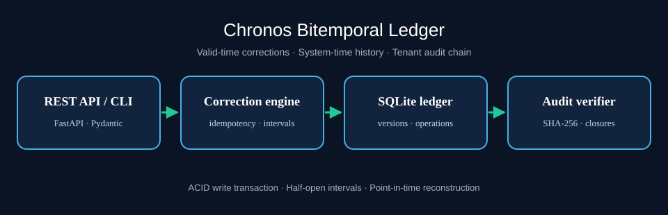

# Chronos Bitemporal Ledger

**Reconstruct what a business system believed at a particular moment, without losing backdated corrections.**

Chronos is a Python reference service for bitemporal data. It stores two independent dimensions: **valid time** (when a business fact applies) and **system time** (when a particular version entered the ledger). This is useful for financial pricing history, compliance evidence, entitlement changes, and operational incident reconstruction.

Maintainer: **Sailesh** (`saileshfaze`) · License: **MIT** · Status: **reference implementation**

## Why it exists

A conventional `updated_at` column cannot answer both questions:

1. What price applied to a contract on 1 March?
2. What did our system *believe* that price was on 15 February, before a correction arrived?

Chronos preserves both answers. Corrections are scoped to half-open date intervals, split overlapping current segments, and retain the superseded rows for earlier system-time queries. Operations are serialized through SQLite transactions and linked with SHA-256 digests for integrity checks.

## Architecture



- **API:** FastAPI and Pydantic validation for corrections, snapshots, history and audit.
- **Write engine:** `BEGIN IMMEDIATE`, tenant-scoped idempotency, interval splitting and system-time closure.
- **Storage:** SQLite WAL mode, indexed historical versions and immutable operation identifiers.
- **Audit:** Hash-linked tenant operations, write digests and closure consistency checks.
- **Tooling:** CLI, deterministic synthetic event generator, replay-safe loader, pytest suite and Docker.

## Quick start

```bash
python -m venv .venv
source .venv/bin/activate
pip install -e '.[dev]'
pytest -q
python scripts/generate_dataset.py --output data/generated_events.jsonl
chronos-ledger --db ./chronos.sqlite3 ingest data/generated_events.jsonl
chronos-ledger --db ./chronos.sqlite3 query tenant-00 plan-000 2026-06-01
chronos-ledger --db ./chronos.sqlite3 audit tenant-00
uvicorn chronos_ledger.api:app --reload
```

For Docker: `docker compose up --build`. The compose service binds to localhost by default; it is not a production authentication boundary.

## Minimal HTTP example

```bash
curl -X POST http://127.0.0.1:8000/v1/tenants/acme/entities/contract-7/corrections \
  -H 'Content-Type: application/json' \
  -d '{"valid_from":"2026-01-01","valid_to":"2027-01-01","payload":{"monthly_eur":49},"actor":"demo","idempotency_key":"contract-7-v1"}'

curl 'http://127.0.0.1:8000/v1/tenants/acme/entities/contract-7?valid_at=2026-03-01'
```

`known_at` is optional on reads. Provide an ISO-8601 timezone-aware timestamp to reconstruct what was recorded by that system-time instant.

## Semantics and guarantees

- Intervals are **[valid_from, valid_to)**, with exclusive end dates.
- One correction replaces the overlapping portions of all *current* intervals for the same tenant/entity; uncovered historical intervals are preserved as new current segments.
- A retry with the same tenant/idempotency key and identical request returns the original receipt; a changed request returns HTTP 409.
- Each write receives a monotonic UTC system timestamp **per tenant** (even if the injected clock moves backwards).
- An audit report checks chained operation metadata, payload digests, inserted-row digests and historical closures.
- The reference implementation intentionally leaves gaps where no facts have been recorded.

## Repository layout

| Path | Purpose |
| --- | --- |
| `src/chronos_ledger/service.py` | Transactional correction and two-time-axis query engine |
| `src/chronos_ledger/audit.py` | Per-tenant chain verification and closure validation |
| `src/chronos_ledger/api.py` | REST interface and OpenAPI |
| `src/chronos_ledger/cli.py` | Import, snapshot and audit commands |
| `migrations/001_init.sql` | SQL schema for independent inspection |
| `scripts/` | Deterministic data, loader, smoke and benchmark utilities |
| `tests/` | Interval, history, idempotency, audit, concurrency and API tests |
| `docs/` | Design, API, threat model, operations and known limitations |
| `ci/github-actions-template.yml` | Workflow template; copy to repository-root `.github/workflows/` to activate |

## Design boundaries

This is a single-node educational/reference implementation, **not** a deployed compliance product. The HTTP API has **no authentication or tenant authorization**. The audit chain is stored in the same database as the data, so a privileged adversary who can rewrite the entire database can forge history. There is no external timestamping, replication, backup automation, distributed consensus, legal retention policy or formal performance SLO. See [limitations](docs/limitations.md) and [security](docs/security.md) before adapting it.

## Development and validation

```bash
pytest -q
ruff check src tests scripts
python -m compileall -q src
python scripts/benchmark.py --events 100 --db /tmp/chronos-benchmark.sqlite3
```

The CI configuration is a **template**, not an active repository workflow. Tests should be rerun in the target deployment environment. Synthetic datasets contain no real customer data.
