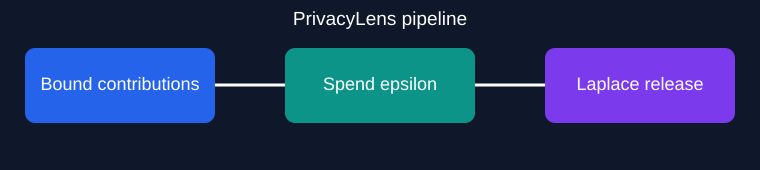

# PrivacyLens — Differential Privacy Analytics Lab

A reproducible, synthetic-data laboratory for bounded contributions, Laplace-mechanism histograms, bounded means and basic sequential privacy-budget accounting. Portfolio project maintained by **Sailesh**.



## Quickstart

```bash
python scripts/generate_data.py
python scripts/generate_assets.py
python -m pip install -e '.[test]'
pytest -q
privacylens data/synthetic_users.csv --epsilon 1 --budget 2
```

Optional API: `pip install -e '.[api]' && uvicorn privacylens.api:app --host 127.0.0.1 --port 8000`.

## Architecture

The package separates contribution bounding, epsilon accounting, Laplace releases and CLI/API adapters. The CLI uses a fixed pseudorandom seed **only** for reproducible synthetic demonstrations. The optional API uses system randomness but does **not** enforce cross-request accounting.

## Threat model and limitations

**Do not use for real personal data or production privacy guarantees.** Each record must represent a distinct individual after contribution bounding, and categories and clipping bounds must be public. A private count is not provided; mean queries require a genuinely public count. The basic ledger is in-memory and cannot prevent repeated requests across sessions or API calls. No secure multi-user budget service, privacy-proof audit, robust ingestion controls, or adversarial validation is provided. See [privacy model](docs/privacy-model.md).

## License

MIT — Copyright (c) 2026 Sailesh.
