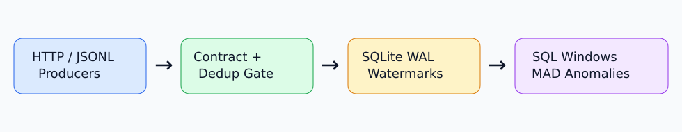
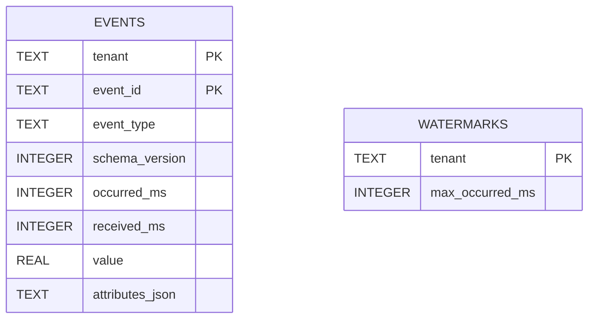

# Architecture

## Data path

1. HTTP batches or CLI JSONL records are parsed into strict Pydantic event envelopes.
2. The bundled `contracts.json` registry validates required attributes per event type and schema version.
3. A SQLite `BEGIN IMMEDIATE` transaction checks the composite `(tenant, event_id)` primary key and tenant high-water mark, then inserts an event and advances the watermark atomically.
4. Indexed SQL queries aggregate events into UTC-aligned, half-open tumbling windows.
5. A median/MAD scoring pass detects unusually high or low counts independently for each event type.

## Reliability model

- **Deduplication:** retries with the same event ID within the same tenant return `duplicate`. IDs reused for different payloads are treated as duplicates; producers must generate stable IDs.
- **Late data:** a tenant's maximum observed event timestamp determines the watermark. Records older than `max_timestamp - allowed_lateness` return `late`. This is not a wall-clock expiry check.
- **Atomicity:** each accepted event is transactional. A batch validates all contracts before ingestion, but a later event-time error may leave earlier records accepted; API consumers should retry safely using event IDs.
- **Ordering:** windows use event time, not arrival time. UTC timestamps avoid DST ambiguity.
- **Isolation:** every read and write includes tenant scope; production multi-tenant authorization requires authenticated tenant binding.
- **Observability:** metric labels use status only to avoid tenant-cardinality explosion.

## Data model

## Scale-out path

For higher throughput, replace the SQLite adapter with Kafka + partitioned stream processing and a durable analytical store. Key event IDs by tenant, partition by tenant/entity, retain contract compatibility policies, and move watermarks to partition-aware state. Avoid claiming distributed exactly-once semantics without broker and sink transactional guarantees.
