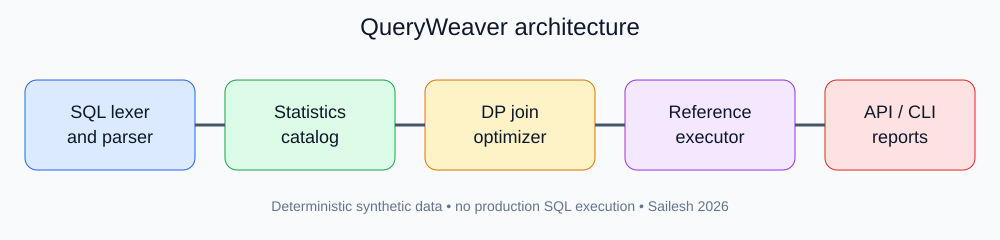

# QueryWeaver — Cost-Based SQL Planner Lab

Sailesh / saileshfaze · 2026 · MIT

QueryWeaver is an inspectable SQL planning laboratory. It parses a constrained SELECT dialect, validates schema references, estimates filter and join selectivity, and uses Selinger-style left-deep dynamic programming to choose join order and physical operators. A deterministic Python executor checks query-result equivalence against a fixed-order nested-loop baseline.

## Capabilities

- Typed SQL AST with bounded lexer and strict syntax rejection.
- Inner equijoins across up to eight aliases, projection, literal filters and LIMIT.
- Row-count, distinct-value and numeric-range statistics.
- Table/index access estimates; hash, nested-loop and modeled indexed nested-loop joins.
- Cost estimates, explain trees, Graphviz DOT, plan invariants, and seeded benchmark.
- Deterministic synthetic star-schema fixtures, FastAPI /plan endpoint, CLI and pytest tests.

## Run

Install with: python -m pip install -e '.[api,dev]'

Run tests: python -m pytest -q

CLI demo: queryweaver --execute

Query file: queryweaver --sql-file examples/four_way.sql --format json

Export fixtures: queryweaver --export-data out/dataset

Seeded invariants: python scripts/check_invariants.py --seeds 30

API: uvicorn queryweaver.api:app --host 127.0.0.1 --port 8000

POST /plan accepts JSON containing sql, seed, execute and allow_cross. GET /health reports status. Core modules require Python 3.11+ standard library; API and test extras are optional.

## Project structure

src/queryweaver: lexer, parser, AST, catalog, planner, executor, diagnostics, benchmark, API and CLI.

tests: parser rejection, schema checks, plan invariants, result equivalence, synthetic fixtures and service tests.

data: deterministic generated CSV fixtures. scripts: asset and dataset regeneration, seeded invariants, benchmark and API smoke tests.

docs: dialect, architecture, cost model, operations and limitations. .github/workflows/ci.yml is a **nested template**, not an active repository-root workflow.

## Boundaries

This is a reference implementation, not a database or production query optimizer. The cost model is uncalibrated and assumes independent predicates. Indexed access paths are modeled by the planner but not physically implemented by the executor. No outer joins, aggregation, ORDER BY, arbitrary SQL, or live database connections. Benchmark timings are machine-dependent and not evidence of production speedups.

Copyright (c) 2026 Sailesh. MIT license.
