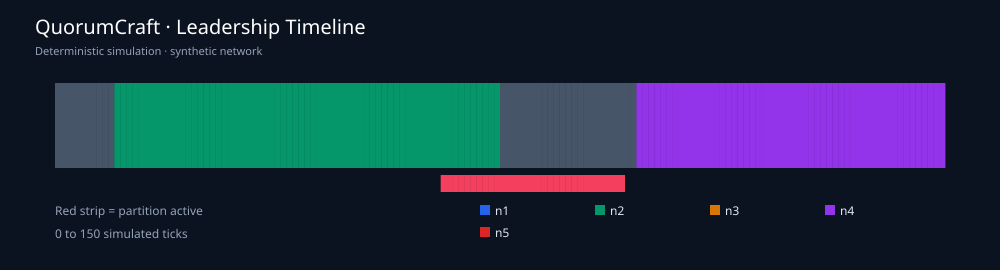

# QuorumCraft · Raft Fault Lab

**Deterministic distributed-systems simulation with fault injection, replication and safety checks.**

QuorumCraft implements a deliberately scoped Raft-style replicated key/value state machine. It models leader election, RequestVote RPCs, AppendEntries RPCs, majority commits, delayed and dropped packets, network partitions, crash/recovery, and convergent state-machine application. Every simulation tick is reproducible from a seed and action script.



> **Scope:** This is an educational discrete-event simulator, not a production Raft library. It does not implement durable fsync, snapshots, membership changes, joint consensus, linearizable read-index, pre-vote, cryptographic authentication or a real network stack. The API is a local simulation controller and must not be exposed to untrusted users.

## Architecture

```text
CLI / FastAPI / scenario JSON
           |
       Cluster.tick()
           |
   seeded transport queue <---- partition / loss / latency
           |
  +--------+---------+---------+---------+
  |        |         |         |         |
 node n1  node n2   node n3   node n4   node n5
  |        |         |         |         |
  +--------+---------+---------+---------+
           |
  quorum commit + state-machine apply
           |
  safety assertions / audit chain / metrics
           |
       JSON + SVG export
```

## Quick start

Python 3.11+:

```bash
python -m venv .venv
source .venv/bin/activate
pip install -e '.[dev]'
pytest -q
quorumcraft demo --output out/demo.json --svg out/timeline.svg
quorumcraft verify out/demo.json
quorumcraft scenario data/partition-heal.json --output out/replay.json
```

To serve a local API:

```bash
quorumcraft serve --host 127.0.0.1 --port 8080
curl -s http://127.0.0.1:8080/health
curl -s -X POST http://127.0.0.1:8080/tick -H 'Content-Type: application/json' -d '{"steps":35}'
curl -s -X POST http://127.0.0.1:8080/commands -H 'Content-Type: application/json' -d '{"request_id":"demo-1","op":"put","key":"stock","value":25}'
curl -s -X POST http://127.0.0.1:8080/tick -H 'Content-Type: application/json' -d '{"steps":20}'
```

Container configuration is supplied as a reproducible template: `docker compose up --build`. This command has not been validated against a running Docker daemon in the local authoring environment.

## What is implemented

| Component | Behavior |
|---|---|
| Election | Seeded randomized timeouts, per-term votes, candidate log freshness checks |
| Replication | AppendEntries consistency checks, conflict truncation, follower catch-up |
| Commit | Majority replication, current-term-only leader commit advancement |
| State machine | Deterministic `put`, `delete`, `increment`, request-id deduplication |
| Fault injection | Bidirectional partitions, packet loss, delay, crash/recover |
| Safety | Leader uniqueness per term, committed prefix agreement, applied-state agreement |
| Observability | Leadership timeline, packet counters, chained event audit, SVG export |
| Reproduction | Scenario JSON, fixed seeds, synthetic fixtures, CLI and test matrix |

## Demonstration scenario

`data/partition-heal.json` runs a five-node cluster for 150 ticks, writes two commands, partitions nodes 1–2 from nodes 3–5, heals the partition, then writes another command. The sample run converges on `orders = 15` across all five nodes for the bundled seed. This is a **synthetic result**, not a measured network benchmark.

## Tests and verification

The tests cover election, replication, majority requirements, duplicate requests, follower recovery, network partitions, audit tampering, JSON exports, API validation, CLI behavior, seeded stress runs and safety invariant failures. Run `python scripts/stress_matrix.py --seeds 100` for additional deterministic scenarios. See [test strategy](docs/testing.md) and [safety assumptions](docs/safety.md).

The nested `.github/workflows/ci.yml` is a **template** and does not run automatically in this repository layout. Copy it to the repository root workflows directory to activate it. No external deployment or production certification is claimed.

## Project map

- `src/quorumcraft/raft.py`: core protocol and replicated state machine
- `src/quorumcraft/network.py`: deterministic transport and fault injection
- `src/quorumcraft/invariants.py`: safety assertions
- `src/quorumcraft/audit.py`: SHA-256 event audit chain
- `src/quorumcraft/scenarios.py`: scenario runner
- `src/quorumcraft/metrics.py`, `report.py`, `persistence.py`: analytics and export
- `src/quorumcraft/api.py`, `cli.py`: external interfaces
- `data/`: synthetic scenario fixtures and sample metrics
- `scripts/`: generation, smoke, stress and reproducibility utilities
- `docs/`: protocol notes, limitations, API, security and design choices

## Ownership and license

Maintained as part of the [saileshfaze portfolio](https://github.com/saileshfaze/Projects_). MIT licensed. Copyright (c) 2026 Sailesh.
