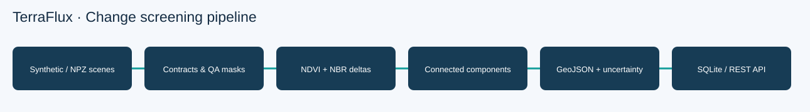

# TerraFlux · Geospatial Change Lab

**Reproducible multispectral change screening, georeferenced evidence and honest uncertainty.**

TerraFlux compares two co-registered red/NIR/SWIR scenes, masks cloudy pixels, screens for vegetation loss using NDVI and NBR drops, groups candidate pixels into eight-connected patches, and exports pixel-accurate GeoJSON MultiPolygons. A spatial block bootstrap estimates uncertainty in the changed-pixel fraction. An optional FastAPI service persists deterministic analysis reports in SQLite.



## Why this exists

Change maps are easy to render and easy to overinterpret. This implementation keeps data validation, cloud exclusions, spectral thresholds, patch extraction, geographic area accounting, and evaluation visible. It deliberately avoids presenting synthetic benchmark performance as field accuracy.

## Quick start

```bash
python -m venv .venv
source .venv/bin/activate
pip install -e '.[dev]'
terraflux generate --root data/generated --id demo --size 96 --seed 7
terraflux analyze demo --root data/generated --output out/report.json
terraflux evaluate demo --root data/generated
terraflux quicklook demo --root data/generated --out out/images
pytest -q
```

To create a complete reproducible report and image bundle: `python scripts/demo.py`. To verify report determinism: `python scripts/check_determinism.py`.

```bash
cp .env.example .env
# Set environment variables from .env in your shell or Docker Compose.
uvicorn terraflux.api:app --host 127.0.0.1 --port 8000
curl http://127.0.0.1:8000/health
curl -X POST http://127.0.0.1:8000/analyze -H 'Content-Type: application/json' -d '{"dataset_id":"demo"}'
```

## Design decisions

- **Strict scene contract:** exactly three reflectance bands in `[0,1]`, boolean QA mask, identical grid, north-up affine transform, EPSG:3857 only. No silent reprojection or resampling.
- **Interpretable baseline:** candidate vegetation loss requires NDVI and NBR drops and sufficient baseline NDVI. This is a rule-based screen, not a trained land-cover classifier.
- **Exact pixel footprint:** a patch's GeoJSON uses horizontal pixel runs rather than inflated bounding boxes; output CRS is explicitly EPSG:3857. A GIS viewer may need reprojection to WGS84.
- **Spatial uncertainty:** resampling blocks rather than independent pixels partially reflects spatial dependence, but the interval is descriptive and not a calibrated probability of ecological change.
- **Repeatability:** seeded synthetic generation, stable patch ordering, deterministic bootstrap, canonical JSON hashing, and idempotent SQLite run IDs.
- **API boundary:** analysis accepts only dataset slugs under a configured root, never arbitrary user paths. This is not a hardened public multi-tenant service.

## Architecture

`NPZ scenes → contract validation → cloud masking → spectral deltas → connected patches → GeoJSON / block bootstrap → REST / SQLite`

## Repository map

| Path | Purpose |
| --- | --- |
| `src/terraflux/models.py` | Scene contract and thresholds |
| `src/terraflux/spectral.py` | NDVI, NBR, candidate change mask |
| `src/terraflux/geometry.py` | Connected components and exact pixel-cell geometry |
| `src/terraflux/uncertainty.py` | Spatial block bootstrap |
| `src/terraflux/pipeline.py` | End-to-end change report |
| `src/terraflux/synthetic.py` | Seeded synthetic scenes and truth |
| `src/terraflux/evaluation.py` | Cloud-aware precision, recall, F1, IoU |
| `src/terraflux/api.py` | FastAPI endpoints and dataset registry |
| `src/terraflux/store.py` | Content-addressed SQLite reports |
| `tests/` | Unit, integration, and contract tests |
| `docs/` | Algorithms, data contract, API, security, operations and limitations |
| `scripts/` | Demo, reproducibility and diagram generation |

## Local evidence

The included tests cover spectral math, cloud exclusion, geometry, strict grid alignment, synthetic evaluation, dataset safety, persistence, API, CLI, and determinism. Test status must be checked in the current environment; CI is provided as a **workflow template** under `ci/` because GitHub Actions only activates workflows located at the repository root `.github/workflows/`.

## Limitations

This is a research/engineering demonstration, not a satellite-processing product. No atmospheric correction, topographic correction, sensor harmonization, geometric registration, probabilistic land-cover inference, or calibrated real-world validation is included. EPSG:3857 areas are *projected* square metres and are distorted relative to ground area, especially at high latitude. Synthetic imagery has simplistic textures and changes. See [limitations](docs/limitations.md).

**Owner / maintainer:** Sailesh (`saileshfaze`) · **License:** MIT, Copyright (c) 2026 Sailesh.
