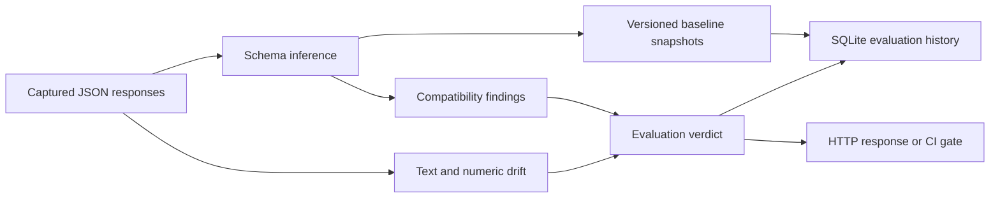

# Architecture and design boundaries

## Components

1. **Ingress:** FastAPI validates JSON samples (1–1000 objects/request) and optional numeric field paths.
2. **Contract inference:** `app/schema.py` infers a JSON-like shape for each sample, then merges observations. Required properties are the intersection of observed keys. Empty arrays carry `unknown` element type.
3. **Compatibility:** A recursive comparison classifies required-field disappearance, type widening, and required-to-optional transitions as breaking. Additive properties are informational.
4. **Drift:** `app/drift.py` uses token/bigram cosine similarity for text and PSI/KS for optional numeric paths. Default operation is deterministic and offline.
5. **Persistence:** `app/storage.py` uses SQLite with WAL, foreign keys and transactional `BEGIN IMMEDIATE` for per-contract version assignment. Snapshots and evaluations are append-only.
6. **Consumers:** JSON REST API, Swagger/OpenAPI, and a nonzero-exit CLI gate.

## Data flow

## Trade-offs

- **SQLite** avoids an external service for a reproducible demo. A multi-writer deployment should move to PostgreSQL with explicit schema migrations.
- **Observed shape inference** is simpler than accepting arbitrary JSON Schema, but is not a replacement for producer-defined contracts. Sample coverage and cardinality matter.
- **Lexical similarity** requires no model weights or outbound network; it cannot understand paraphrases reliably. An optional local embedding backend is isolated behind `app/semantic.py`.
- **PSI/KS** provide signals rather than automatic release decisions. They are sensitive to distribution and sample size.
- **Versioned baselines** preserve history; there is no destructive baseline overwrite endpoint.

## Extension points

Provider-specific sample collectors, JSON Schema/OpenAPI ingestion, Kafka capture, signed release attestations, PostgreSQL, model-based semantic drift, metrics exporters and multi-tenant authorization can be added behind these boundaries.
