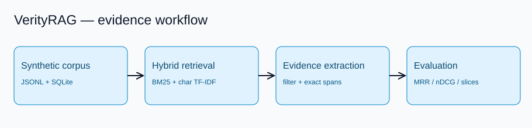

# VerityRAG Evidence Lab

A reproducible, **offline retrieval and evidence-evaluation workbench**. I built it to explore how retrieval quality, citation integrity, and abstention behavior can be tested before adding a generative model.



## Why this project

A fluent answer is not evidence. This baseline deliberately separates *finding documents* from *extracting attributable passages*. It measures ranking against labeled queries, verifies source offsets, and refuses to fabricate answers when no passage meets a simple lexical-overlap rule.

**No LLM is used.** Character-trigram TF-IDF is a spelling-tolerant lexical signal, **not** a semantic embedding model. All runbook text and evaluation labels are synthetic.

## Features

- Hybrid retrieval: BM25 and character-trigram TF-IDF cosine, fused with reciprocal rank fusion (RRF).
- Extractive answers with source IDs, exact character offsets, and post-hoc citation verification.
- Conservative document-level filtering of obvious prompt-injection instructions and email/phone masking in answer text.
- Offline evaluation: Recall@k, Precision@k, MRR@k, nDCG@k, deterministic bootstrap intervals, and per-slice reporting.
- Transactional SQLite corpus upserts, content hashes, and stored evaluation snapshots.
- FastAPI service, CLI, synthetic benchmark, Docker and Compose, CI workflow template, and architecture diagram generator.

## Quick start

```bash
python -m venv .venv
source .venv/bin/activate
pip install -e '.[dev]'
python scripts/generate_data.py
verityrag --db ./demo.db ingest data/documents.jsonl
verityrag --db ./demo.db search 'redis cache expiration'
verityrag --db ./demo.db answer 'When do redis cache entries expire?'
verityrag --db ./demo.db evaluate data/questions.jsonl data/qrels.jsonl
python scripts/run_benchmark.py
pytest -q
ruff check src tests scripts
```

### API

```bash
uvicorn verityrag.api:app --reload
curl -s -X POST http://127.0.0.1:8000/v1/documents \
  -H 'Content-Type: application/json' \
  --data '{"documents":[{"id":"runbook-1","title":"Cache policy","body":"Cache entries expire after fifteen minutes."}]}'
curl -s -X POST http://127.0.0.1:8000/v1/answer \
  -H 'Content-Type: application/json' \
  --data '{"query":"When do cache entries expire?","k":5}'
```

The API also exposes `/health`, `/v1/search`, and `/v1/evaluate`. Swagger UI is at `/docs`.

### Docker

```bash
docker compose up --build
```

The Compose port binds to localhost only. The container runs as a non-root user. **No authentication or rate limiting is included**; do not expose it to the public internet.

## Design decisions

1. **Deterministic baseline:** the same corpus and query produce the same ordering; ties break by document ID. This makes regression testing possible.
2. **Hybrid without network:** BM25 handles precise terminology; trigrams tolerate some typos. RRF avoids pretending that the two score scales are comparable.
3. **Traceable evidence:** answers are source substrings, not generated paraphrases. Each citation can be checked against the unredacted stored body.
4. **Explicit abstention:** if evidence overlap is insufficient, the answer is `Insufficient evidence.` The threshold is a heuristic, not calibrated probability.
5. **Synthetic-first:** fictional operational runbooks avoid customer data and make the evaluation portable.

## Evaluation and limitations

See [evaluation methodology](docs/evaluation.md), [architecture](docs/architecture.md), [threat model](docs/security.md), and [operations](docs/operations.md). Important limitations: tiny labeled corpus, lexical rather than semantic retrieval, English-only tokenization, whole-document injection filtering, non-calibrated overlap threshold, and SQLite/synchronous indexing intended for local-scale workloads. Relevance labels are illustrative, not independently adjudicated.

## Project layout

```text
src/verityrag/   retrieval, grounding, evaluation, storage, API and CLI
tests/           unit and API integration tests
data/            synthetic corpus, questions, relevance labels
scripts/         deterministic data, diagram and benchmark generation
ci/              GitHub Actions template (not automatically active)
docs/            architecture, evaluation, API, security, operations
assets/          reproducible SVG diagram
```

## License

MIT. Copyright (c) 2026 Sailesh. Maintainer: `saileshfaze`.
