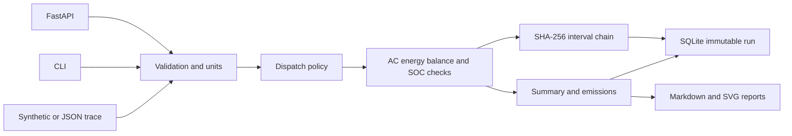

# Architecture

The simulation core is side-effect-free: given a profile, site and policy it returns a summary and interval decisions. Persistence and transport adapters live outside the core. All timestamps are timezone-aware and contiguous. SQLite records are content-addressed by configuration, summary and audit head, so repeated identical runs are idempotent.

Audit-chain verification detects accidental or malicious changes to a stored chain, but it is **not** a digital signature and cannot defend against an attacker who can rewrite the entire database and hashes. For stronger guarantees anchor the final hash externally.
